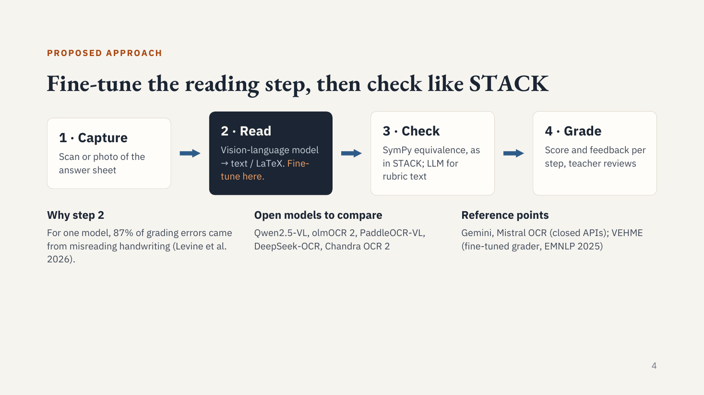

# ai-seminar

**Grading handwritten exam answers with vision-language models** 
JKU Linz · MSc Artificial Intelligence · Seminar in AI (Institute for Machine Learning), WS 2026/27. 
Planned to continue as Practical Work and Master thesis.

## Idea

Tools like ETH's STACK grade *typed* math by meaning (2(x+1) = 2x+2), but students must type.
Handwritten exams are still graded by hand. Gradescope only groups similar answers, so a human still decides.
This project asks whether an open vision-language model (VLM) can **read** the handwriting so that an automatic **check** can grade it.

## Scope

| Task | Public data | Verdict |
|---|---|---|
| Handwritten math | FERMAT, CHECK-MAT, MathWriting, DrawEduMath | Main focus |
| Fill-the-gaps / short answers | No public handwritten graded set → synthetic handwriting from SciEntsBank / Beetle / SAF | Secondary |
| Free-text essays | No public handwritten essays with grades (VisEssay not downloadable, BRESSAY has no grades) | Out of scope for now |

Public datasets only. No own data collection.

## What the research says

- Reading is the bottleneck. In Levine et al. (AIED 2026), 87% of grading errors came from misreading handwriting.
- Models "fix" student mistakes while transcribing (42–66% of cases, Seong et al. 2026), so errors disappear before grading.
- VEHME (EMNLP 2025) is the only open fine-tuned grader for handwritten math, which makes it a direct baseline.

## Draft research questions

1. **Fine-tuned small model.** Does LoRA on Qwen3-VL-4B close the gap to closed models in error detection on FERMAT? *H1: fine-tuned 4B ≥ zero-shot 8B.*
2. **Two-stage vs end-to-end.** Should the model read first and then check (STACK-style), or grade directly from the image? *H2: end-to-end finds more errors (no "fixing"); two-stage is better on final answers.*
3. **Know when to ask a human.** Can the grader abstain on low-confidence answers and stay accurate on the rest? *H3: deferring 20% raises accuracy by ≥ 5 pp.*

## Next steps

- Download FERMAT and MathWriting and check their licences.
- Run a zero-shot baseline: Qwen2.5-VL vs Gemini on a FERMAT subset.
- Prototype the SymPy equivalence check.
- Read 5 core papers closely and skim about 20.
- Pick the seminar paper (candidates: VEHME, Henkel et al. 2025).

## Repository

| Path | Content |
|---|---|
| `AI_Seminar_Meeting2.pptx` / `.pdf` | Supervisor meeting 2: proposal, research, resources, RQs, paper list |
| `Handwritten Exam Grading – Update 1.pdf` | Update 1: STACK comparison, datasets, approach |
| `AI_Seminar_Proposal_v2_draft_ideas.pptx` / `.pdf` | Earlier proposal draft |
| `papers/` | 35 papers. `A_read_closely/` holds the 12 most relevant and `B_skimmed/` the 23 further ones. The index with links is in [`papers/README.md`](papers/README.md) |

Papers are the authors' work (mostly arXiv preprints), collected here for study. Original links are in the index.
