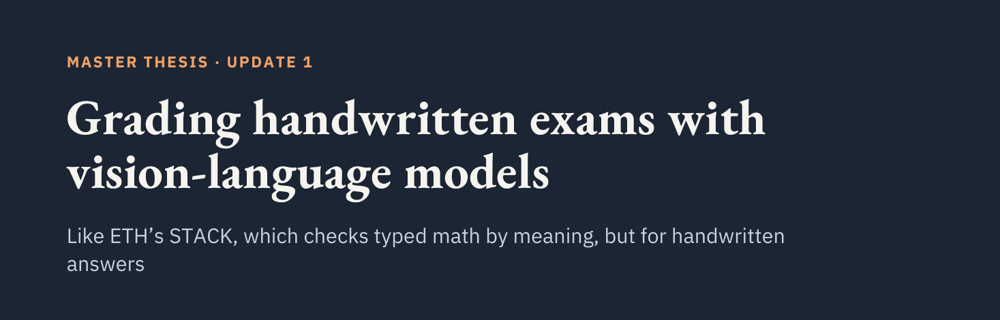
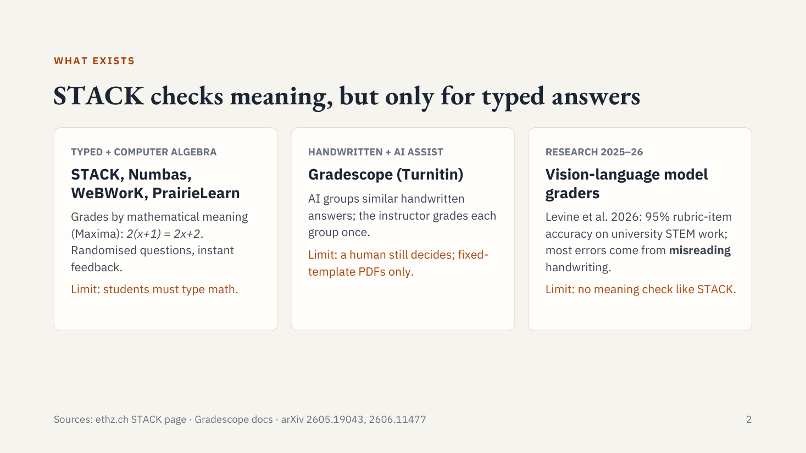
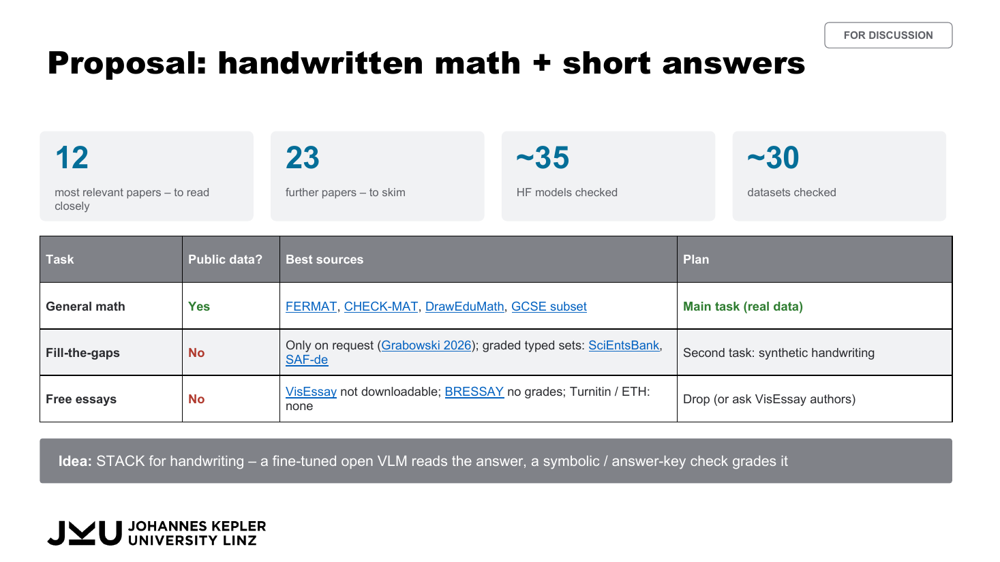
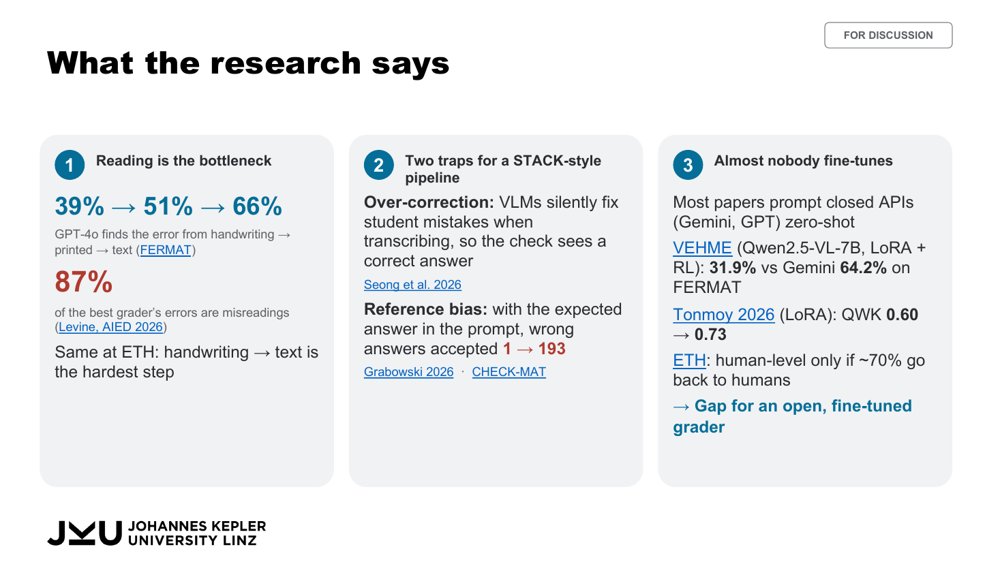
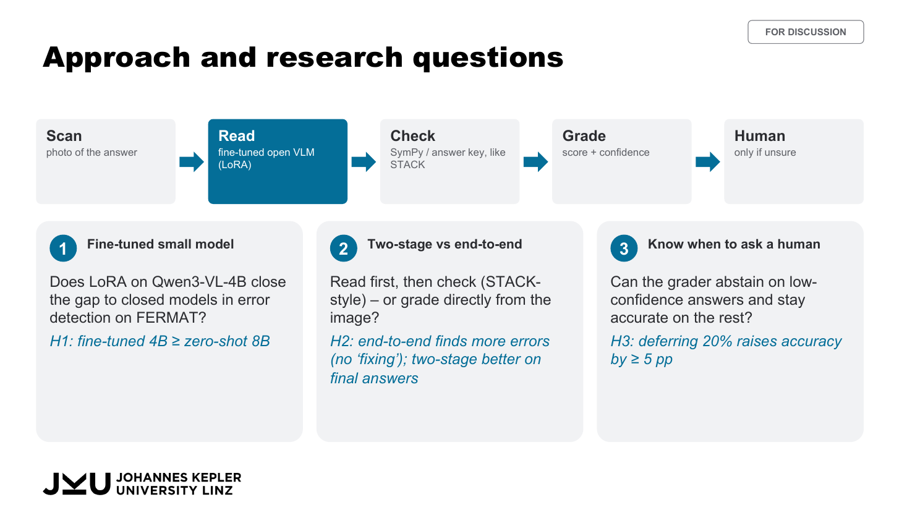
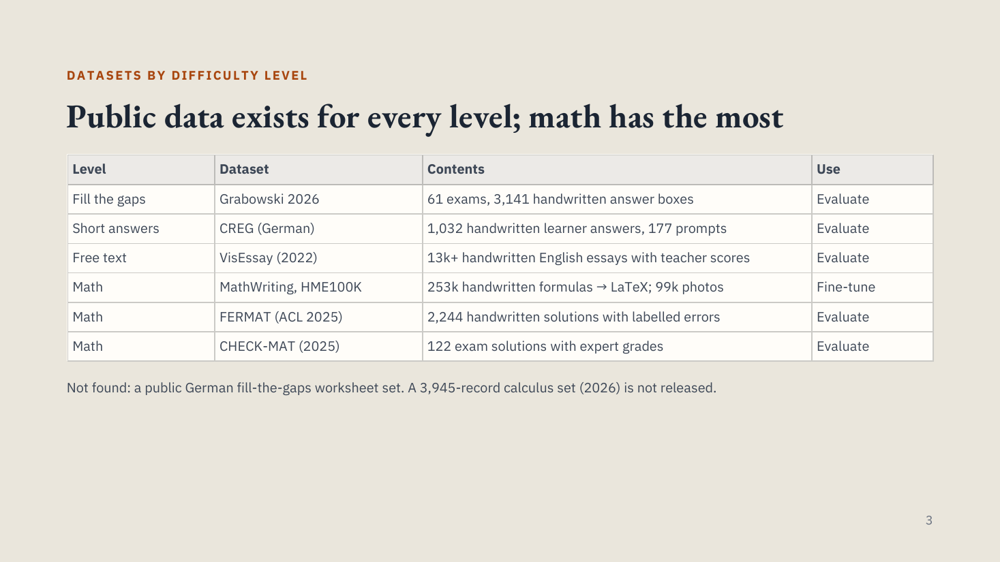
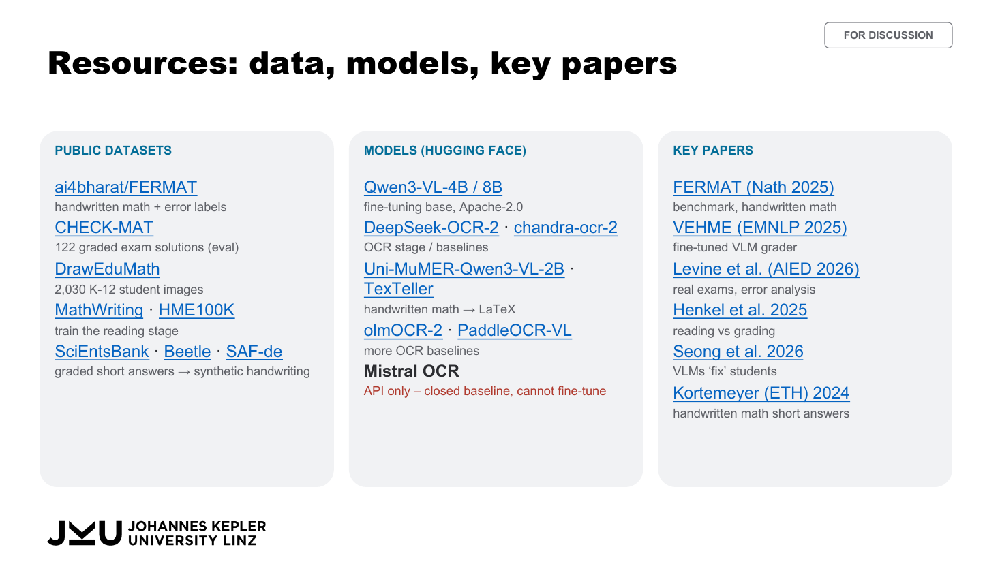
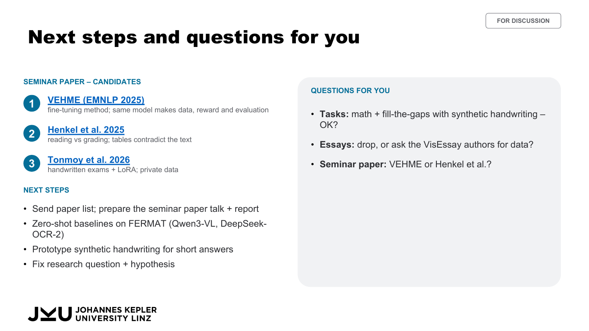
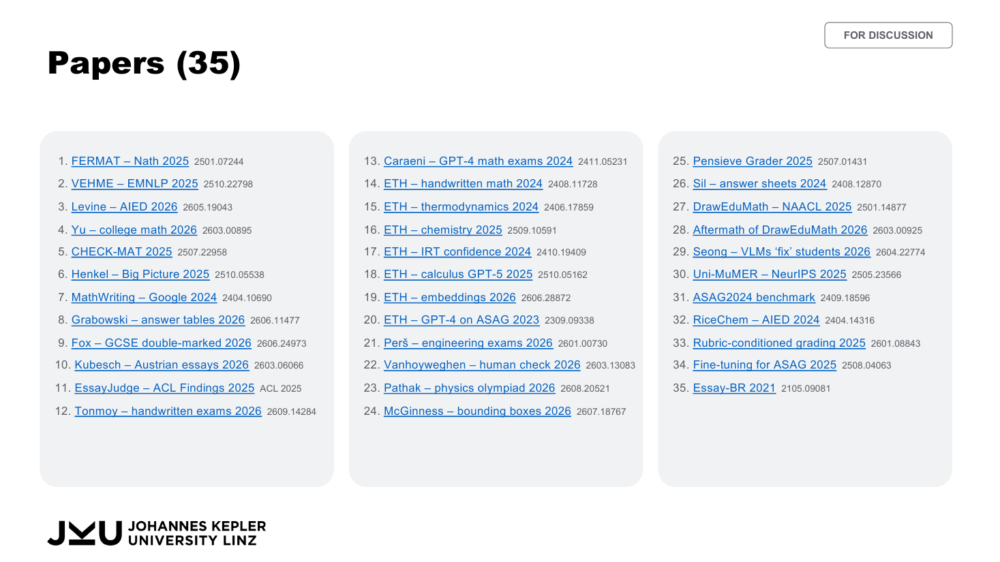

  

  <b>JKU Linz · MSc Artificial Intelligence · Seminar in AI (Institute for Machine Learning) · WS 2026/27</b> 
  Planned to continue as Practical Work and Master thesis

  
  
  
  

---

## 💡 Idea

> **STACK for handwriting.** A fine-tuned open vision-language model reads the answer, and a symbolic / answer-key check grades it.

Tools like ETH's **STACK** grade *typed* math by meaning (`2(x+1) = 2x+2`), but students have to type. Handwritten exams are still graded by hand. **Gradescope** only groups similar answers, so a human still decides.

## 🔁 Approach

| 1 · Scan | → | 2 · Read | → | 3 · Check | → | 4 · Grade | → | 5 · Human |
|:---:|:---:|:---:|:---:|:---:|:---:|:---:|:---:|:---:|
| photo of the answer | | **fine-tuned open VLM (LoRA)** → LaTeX / text | | SymPy / answer key, like STACK | | score + confidence | | only if unsure |

## 🎯 Scope

| Task | Public data | Verdict |
|---|---|---|
| ✅ **Handwritten math** | FERMAT, CHECK-MAT, MathWriting, DrawEduMath | Main focus |
| 🟡 **Fill-the-gaps / short answers** | No public handwritten graded set → synthetic handwriting from SciEntsBank / Beetle / SAF | Secondary |
| ❌ **Free-text essays** | No public handwritten essays with grades (VisEssay not downloadable, BRESSAY has no grades) | Out of scope for now |

Public datasets only. No own data collection.

## 🔬 What the research says

- 📖 **Reading is the bottleneck.** In Levine et al. (AIED 2026), **87%** of grading errors came from misreading handwriting.
- 🪄 **Over-correction.** Models "fix" student mistakes while transcribing (**42–66%** of cases, Seong et al. 2026), so errors disappear before grading.
- 🧩 **Gap.** VEHME (EMNLP 2025) is the only open fine-tuned grader for handwritten math, so it is the direct baseline.

## ❓ Research questions

1. **Fine-tuned small model.** Does LoRA on Qwen3-VL-4B close the gap to closed models in error detection on FERMAT? *H1: fine-tuned 4B ≥ zero-shot 8B.*
2. **Two-stage vs end-to-end.** Should the model read first and then check (STACK-style), or grade directly from the image? *H2: end-to-end finds more errors (no "fixing"); two-stage is better on final answers.*
3. **Know when to ask a human.** Can the grader abstain on low-confidence answers and stay accurate on the rest? *H3: deferring 20% raises accuracy by ≥ 5 pp.*

## 📦 Data, models, papers

<table>
  <tr>
    <td width="50%"></td>
    <td width="50%"></td>
  </tr>
</table>

## 🗓️ Next steps

- [ ] Download FERMAT and MathWriting and check their licences
- [ ] Zero-shot baseline: Qwen2.5-VL vs Gemini on a FERMAT subset
- [ ] Prototype the SymPy equivalence check
- [ ] Read 5 core papers closely and skim about 20
- [ ] Pick the seminar paper (candidates: VEHME, Henkel et al. 2025)

<b>Slides: next steps and full paper list</b>

## 📁 Repository

| Path | Content |
|---|---|
| [`AI_Seminar_Meeting2.pdf`](AI_Seminar_Meeting2.pdf) / `.pptx` | Supervisor meeting 2: proposal, research, resources, RQs, paper list |
| [`Handwritten Exam Grading – Update 1.pdf`](Handwritten%20Exam%20Grading%20–%20Update%201.pdf) | Update 1: STACK comparison, datasets, approach |
| [`AI_Seminar_Proposal_v2_draft_ideas.pdf`](AI_Seminar_Proposal_v2_draft_ideas.pdf) / `.pptx` | Earlier proposal draft |
| [`papers/`](papers/README.md) | 35 papers. `A_read_closely/` holds the 12 most relevant and `B_skimmed/` the 23 further ones. The index has links |
| `assets/` | Slide images used in this README |

Papers are the authors' work (mostly arXiv preprints), collected here for study. Original links are in the <a href="papers/README.md">index</a>.
